# Wiring

[Українською](../uk/wiring.md) · [Documentation index](README.md)

The wiring is the same as in the original Clock Informer: a clock built for the author's firmware works with Informer
Clock UA unchanged. The pins below come from the firmware source (`firmware/src`).

## Pin table

| What | ESP32 pin | Notes |
|---|---|---|
| MAX7219 DIN | GPIO23 (D23) | hardware SPI (VSPI) |
| MAX7219 CLK | GPIO18 (D18) | |
| MAX7219 CS | GPIO5 (D5) | |
| Photoresistor | GPIO34 (D34) | divider: 3.3 V → photoresistor → GPIO34 → 10 kΩ → GND |
| WS2812B strip, DIN | GPIO27 (D27) | through a 220 Ω resistor; up to 30 LEDs |
| DFPlayer Mini, RX | GPIO17 (TX2) | a 1 kΩ series resistor is recommended |
| DFPlayer Mini, TX | GPIO16 (RX2) | |
| MH-Z19B, TX | GPIO15 (D15) | ESP receives |
| MH-Z19B, RX | GPIO4 (D4) | ESP transmits |
| Buzzer and LED | GPIO2 (D2) | through a C945 (NPN) transistor, base through 220 Ω |
| Button | GPIO0 | this is the BOOT button on the board; an external one goes in parallel to GND |
| I²C SDA | GPIO21 (D21) | sensors and the real-time clock, 3.3 V supply |
| I²C SCL | GPIO22 (D22) | |
| DS18B20 | GPIO26 (D26) | 4.7–10 kΩ pull-up to 3.3 V |
| DHT11 / DHT22 | GPIO14 (D14) | 10 kΩ pull-up to 3.3 V |

## Power

- A **5 V, 2 A** power supply (the author uses a 5.5×2.1 mm DC jack). 5 V goes to the ESP32 board's **VIN** pin, and to
  the display, the strip and the DFPlayer with separate wires from the supply, not through the board.
- A **1000 µF, 6.3 V** (or higher) electrolytic capacitor across 5 V and GND at the power input — it absorbs the current
  spikes of the matrices and the strip.
- All GNDs are connected together. Sensors are powered from the board's **3V3** pin.
- Powering the clock from a computer's USB is fine for testing only: with all matrices and the strip at full brightness
  USB cannot supply enough current — restarts, garbage on the display.

## MAX7219 display

- **FC16** modules (8×8, usually “4 in 1” boards). One floor — 4 to 16 matrices; two floors — 4 or 8 per floor. The
  number of floors and matrices is set in the first-start wizard and on the “Display” page.
- **Two floors:** ESP32 → DIN of the bottom row (1st floor), its DOUT → DIN of the top row (2nd floor). CLK, CS and power
  go to both rows in parallel. The author's original schematic is wired the same way.
- ESP32 logic is 3.3 V and the MAX7219 runs from 5 V; with most modules this works directly (as in the author's build).
  If the display shows garbage — shorter DIN/CLK/CS wires, a common GND, or a level shifter (e.g. 74HCT125).

## Light sensor (photoresistor 5528)

A voltage divider: 3.3 V → photoresistor → **GPIO34**, and a **10 kΩ** resistor from GPIO34 to GND. The brighter it is,
the higher the ADC value. Brightness mode and threshold — “Display” page (“Brightness type”, “Brightness threshold”).

## WS2812B strip

Strip DIN ← **220 Ω** resistor ← **GPIO27**; +5 V and GND from the power supply. Up to 30 LEDs (the author uses two
strips of 22 LEDs at 144/m, chained). Count, effects and brightness — “LED Light” page.

## Sensors

- **I²C** (SDA GPIO21, SCL GPIO22, 3.3 V supply): BME280, BMP280, BMP180, AHT10, HDC1080, AM2320, SGP30, CCS811,
  SCD40/SCD41; real-time clock DS3231 (the author also mentions DS1307). Several sensors share the bus in parallel.
- **DS18B20** — data to GPIO26 with a 4.7–10 kΩ pull-up to 3.3 V.
- **DHT11 / DHT22** — data to GPIO14 with a 10 kΩ pull-up to 3.3 V.
- **MH-Z19B** (CO₂) — 5 V supply, sensor TX → GPIO15, sensor RX ← GPIO4. **It does not work together with the
  DFPlayer:** both use the same hardware UART1, so choose one.

The sensor type is chosen on the “Sensors” page.

## Voice and sound

- **DFPlayer Mini**: VCC → 5 V, GND, RX ← 1 kΩ ← GPIO17, TX → GPIO16; a 3 W, 4–8 Ω speaker on SPK1/SPK2.
- microSD card (FAT32): copy the contents of
  [sounds_sd_card.zip](https://github.com/roman885-85/informer-clock-ua/releases/download/files/sounds_sd_card.zip)
  (the author's files) to the root: folders `01`–`06` — voices, `15` — melodies before the time announcement,
  `16` — alarm.
- **Buzzer** (without a DFPlayer) and an indicator LED: GPIO2 → 220 Ω → C945 (NPN) base, emitter → GND; the buzzer and
  the LED (with its own 220 Ω) go between 5 V and the collector. Voice or buzzer — choose on the “Sound” page.

## Button

GPIO0 is the **BOOT** button on the ESP32 board. An external button goes in parallel to BOOT: between GPIO0 and GND.
What it does — see the [user manual](https://roman885-85.github.io/informer-clock-ua/manual/?lang=en). Do not hold the
button while powering up: the ESP32 then waits for firmware (bootloader mode) and the clock does not start.

## Original schematic and case

The author's full schematic (all sensors, layout) — [original-esp32-schematic.png](../images/original-esp32-schematic.png)
(by Semen_p, [Thingiverse](https://www.thingiverse.com/thing:3924947), CC BY-NC 4.0).

3D-printable cases (1 and 2 floors) — the author's archive
[clock_cases.zip](https://github.com/roman885-85/informer-clock-ua/releases/download/files/clock_cases.zip).
For the case the author also suggests a 4 mm clear acrylic sheet, window tint film, M3×8 screws and nuts.

The diagram above is generated by `tools/docs/wiring_svg.py` (`python3 tools/docs/wiring_svg.py uk|en`).
