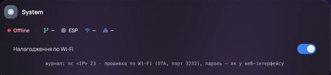

# Налагодження по Wi-Fi

[English](../en/wifi-debug.md) · [Зміст документації](README.md)

Щоб розібратися, що відбувається з годинником, не треба під'єднувати його до комп'ютера кабелем: журнал роботи й
прошивку можна отримати по Wi-Fi. Функція вимикається й вмикається у веб-інтерфейсі.

## Увімкнути

Меню годинника (кнопка зі значком годинника внизу ліворуч; на телефоні — **⋮** внизу праворуч) → **System info & logs**
→ перемикач **«Налагодження по Wi-Fi»**. Під перемикачем з'явиться підказка з адресою годинника. Налаштування
зберігається (ключ `wdbg`) і діє й після перезапуску. Вимкнено — порти закриті, рядки журналу не збираються.



## Журнал роботи (TCP-порт 23)

```sh
nc <адреса-годинника> 23                    # macOS, Linux
nc <адреса-годинника> 23 >> clock.log       # писати у файл (напр. на всю ніч)
```

Windows: [PuTTY](https://www.putty.org/) → Connection type **Raw**, Host — адреса годинника, Port **23**; або
`telnet <адреса> 23` (компонент Telnet Client).

Що в журналі:

- при під'єднанні — шапка: назва й версія прошивки, час роботи, вільна пам'ять, причина старту, остання аварія;
  потім останні ~8 КБ журналу;
- рядки налагодження (ті самі, що в живій консолі веб-інтерфейсу): Wi-Fi, NTP, погода, новини, MQTT, табло;
- помилки ядра Arduino (`log_e`) і ESP-IDF.

Одночасно — до 2 підключень. Журнал не займає WebSocket-з'єднання веб-інтерфейсу (воно в годинника одне).

## Прошивка по Wi-Fi (ArduinoOTA, порт 3232)

Для розробників — записати свою збірку без кабелю:

```sh
cd firmware
pio run -e clock -t upload --upload-port <адреса-годинника>
# якщо в «Налаштуваннях» задано ім'я й пароль веб-інтерфейсу:
PLATFORMIO_UPLOAD_FLAGS="--auth=<пароль>" pio run -e clock -t upload --upload-port <адреса-годинника>
```

Без PlatformIO — `espota.py` з ядра Arduino-ESP32:
`python3 espota.py -i <адреса> -p 3232 -a <пароль> -f firmware.bin`.

Під час запису табло показує «Оновлення прошивки». Протокол espota: годинник сам під'єднується назад до комп'ютера,
тож брандмауер комп'ютера має дозволити вхідні з'єднання для Python/PlatformIO. На macOS Python, установлений не з
системи (зокрема той, що в PlatformIO), без дозволу «Локальна мережа» отримує «No response from the ESP» — тоді
запускайте `espota.py` системним `/usr/bin/python3` і вкажіть адресу комп'ютера: `-I <адреса-Mac>`.

На час запису годинник зупиняє свої служби (MQTT, стрічку, звук, плавну яскравість); веб-інтерфейс працює.

## Журнал подій і аварії

Незалежно від перемикача годинник веде **журнал подій** (меню годинника → System → Event Log): старти, причини
перезапуску, Wi-Fi, оновлення. Якщо годинник аварійно перезапустився, після старту в журналі з'явиться рядок

```
[BOOT] crash: exception LoadProhibited (28) PC=0x400d1234 addr=0x00000000 bt: 0x400d1234 0x400d5678 …
```

Адреси перетворюються на файл і рядок коду за файлом `.elf` тієї самої версії (є серед файлів випуску на GitHub):

```sh
~/.platformio/packages/toolchain-xtensa32/bin/xtensa-esp32-elf-addr2line -pfiaC \
  -e informer-clock-ua-esp32-1.1.2.elf 0x400d1234 0x400d5678
```

Якщо `loop()` завис довше 3 хв, сторож перезапускає годинник і пише `[BOOT] loop guard: loop() stuck > 180 s`.

## Сокети й сила сигналу (з 1.1.0)

- `http://<адреса>/content?wifi_rssi=` — сила сигналу роутера, дБм (−40…−70 — добре; ближче за −30 — годинник
  стоїть надто близько до роутера). У журналі подій — у кожному рядку «Connected».
- `http://<адреса>/content?sock_diag=` — перепис сокетів lwIP (раз на хвилину): `used` — відкриті, `free` — вільні
  місця (рахуються лише з налагодженням по Wi-Fi), `lost` — ні відкриті, ні вільні; далі для кожного відкритого —
  тип (`T` TCP, `U` UDP), порти, адреса, скільки секунд відкритий, задача/етап циклу й ланцюжок викликів `@…`
  (адреси — тим самим `addr2line`). З налагодженням по Wi-Fi той самий рядок `[SOCK] …` іде в журнал — коли щось
  змінилось або раз на 10 хв.
- Якщо сокети все ж закінчились (три перевірки поспіль не створюється жоден), годинник пише в журнал подій
  `[NET ] Restart: no sockets…` і перепис `[SOCK] …` і перезапускається.

## Імітація зникнення роутера (з 1.1.1)

- `http://<адреса>/post?wdbg_wifi_off=N` — годинник N секунд (до 3600) «не бачить» роутера: від'єднується й
  перепідключається до неіснуючої мережі. Діє лише з увімкненим налагодженням по Wi-Fi; у налаштування не пишеться,
  перезапуск імітацію знімає. У журналі подій — `[WIFI] Test: router outage simulated for N s` і
  `[WIFI] Test: simulated outage over`.
- Коротка імітація (2 хв): годинник має повернутися сам за секунди після її кінця, без перезапуску. Довга (30 хв):
  через ~10 хв — `[WIFI] Restart: router unreachable (cycle 3, …)`, перезапуск і одразу `Connected`.

## Стан обробки подій Wi-Fi (з 1.1.2)

- Записи `[NET ] Internet offline — ping failed (…)` і `[NET ] Forced re-association (…)` закінчуються станом Wi-Fi:
  `events N` — скільки подій Wi-Fi обробила задача подій ядра (`network_event`); `last E X s ago` — остання подія
  (номер `system_event_id_t`: 1 — кінець пошуку мереж, 2/3 — старт/стоп станції, 5 — від'єднання, 7 — отримано
  адресу) і коли; `handler busy: event E step S for X s` — обробник стоїть на події E, кроці S (1–2 — від'єднання,
  3–5 — отримання адреси, 6 — старт станції, 99 — імітація) уже X с; `task …` — стан задачі подій і запас її стека;
  `driver: associated / not associated` — чи драйвер Wi-Fi асоційований з роутером; `status N` — `WiFi.status()`
  (3 — «підключено», 6 — «від'єднано», 255 — Wi-Fi вимкнено); `heap` — вільна пам'ять.
- Годинник перезапускається сам, коли бачить, що обробка подій стала: `[WIFI] Restart: Wi-Fi events not delivered
  after re-association (…)` (після примусового перепідключення подій немає 8 с), `[WIFI] Restart: status says
  connected, driver is not (…)` (хвилину поспіль), `[NET ] Restart: router silent, no reconnect since last
  re-association (…)` (запасне правило). Такий журнал варто надіслати в Issues — він показує, на чому стала обробка.
- Імітація (лише з увімкненим налагодженням по Wi-Fi; у налаштування не пишеться): `http://<адреса>/post?wdbg_evt_reassoc=N`
  — обробка подій стає на N с (до 3600), годинник примусово перепідключається; за ~8 с має бути `Restart: Wi-Fi
  events not delivered…` і одразу `Connected`. `http://<адреса>/post?wdbg_evt_block=N` — те саме з обривом зв'язку;
  за ~1 хв — `Restart: status says connected, driver is not…`.

## Безпека

Поки перемикач увімкнено, порт 23 відкритий для всієї локальної мережі (журнал не містить паролів Wi-Fi — їх
приховано), а прошивка по Wi-Fi захищена лише паролем веб-інтерфейсу (якщо його не задано — без пароля). Вимикайте
налагодження, коли воно не потрібне.
