# Підключення

[English](../en/wiring.md) · [Зміст документації](README.md)

Схема — та сама, що в оригінальному Clock Informer: годинник, зібраний для прошивки автора, працює з Informer Clock UA
без змін. Виводи нижче взято з коду прошивки (`firmware/src`).

## Таблиця виводів

| Що | Вивід ESP32 | Примітки |
|---|---|---|
| MAX7219 DIN | GPIO23 (D23) | апаратний SPI (VSPI) |
| MAX7219 CLK | GPIO18 (D18) | |
| MAX7219 CS | GPIO5 (D5) | |
| Фоторезистор | GPIO34 (D34) | дільник: 3,3 В → фоторезистор → GPIO34 → 10 кОм → GND |
| Стрічка WS2812B, DIN | GPIO27 (D27) | через резистор 220 Ом; до 30 світлодіодів |
| DFPlayer Mini, RX | GPIO17 (TX2) | рекомендовано 1 кОм послідовно |
| DFPlayer Mini, TX | GPIO16 (RX2) | |
| MH-Z19B, TX | GPIO15 (D15) | ESP приймає |
| MH-Z19B, RX | GPIO4 (D4) | ESP передає |
| Зумер і світлодіод | GPIO2 (D2) | через транзистор C945 (NPN), база через 220 Ом |
| Кнопка | GPIO0 | це кнопка BOOT на платі; зовнішня — паралельно до GND |
| I²C SDA | GPIO21 (D21) | датчики й годинник реального часу, живлення 3,3 В |
| I²C SCL | GPIO22 (D22) | |
| DS18B20 | GPIO26 (D26) | підтяжка 4,7–10 кОм до 3,3 В |
| DHT11 / DHT22 | GPIO14 (D14) | підтяжка 10 кОм до 3,3 В |

## Живлення

- Блок живлення **5 В, 2 А** (у автора — роз'єм DC 5,5×2,1 мм). 5 В подається на вивід **VIN** плати ESP32, на табло,
  стрічку й DFPlayer — окремими дротами від блока, не через плату.
- Електролітичний конденсатор **1000 мкФ, 6,3 В** (або вище) між 5 В і GND біля входу живлення — гасить кидки струму
  матриць і стрічки.
- Усі GND з'єднані разом. Датчики живляться від виводу **3V3** плати.
- Від USB комп'ютера годинник можна живити лише для перевірки: з усіма матрицями й стрічкою на повній яскравості струму
  USB не вистачить — перезапуски, «сміття» на табло.

## Табло MAX7219

- Модулі **FC16** (8×8, зазвичай збірки «4 в 1»). Один поверх — від 4 до 16 матриць; два поверхи — по 4 або по 8 на
  поверх. Кількість поверхів і матриць задається в майстрі першого запуску й на сторінці «Дисплей».
- **Два поверхи:** ESP32 → DIN нижнього ряду (1-й поверх), його вихід DOUT → DIN верхнього ряду (2-й поверх). CLK, CS
  і живлення — до обох рядів паралельно. Так само на оригінальній схемі автора.
- Логіка ESP32 — 3,3 В, MAX7219 живиться від 5 В; у більшості модулів це працює напряму (як у автора). Якщо на табло
  «сміття» — коротші дроти DIN/CLK/CS, спільний GND, або перетворювач рівнів (напр. 74HCT125).

## Датчик світла (фоторезистор 5528)

Дільник напруги: 3,3 В → фоторезистор → **GPIO34**, і від GPIO34 резистор **10 кОм** на GND. Що світліше, то більше
значення АЦП. Поріг і режим яскравості — сторінка «Дисплей» («Тип яскравості», «Поріг яскравості»).

## Стрічка WS2812B

DIN стрічки ← резистор **220 Ом** ← **GPIO27**; +5 В і GND — від блока живлення. До 30 світлодіодів (у автора — дві
стрічки по 22 світлодіоди за 144/м, з'єднані послідовно). Кількість, ефекти й яскравість — сторінка «LED підсвічування».

## Датчики

- **I²C** (SDA GPIO21, SCL GPIO22, живлення 3,3 В): BME280, BMP280, BMP180, AHT10, HDC1080, AM2320, SGP30, CCS811,
  SCD40/SCD41; годинник реального часу DS3231 (автор згадує й DS1307). Кілька датчиків — на одну шину паралельно.
- **DS18B20** — дані на GPIO26 з підтяжкою 4,7–10 кОм до 3,3 В.
- **DHT11 / DHT22** — дані на GPIO14 з підтяжкою 10 кОм до 3,3 В.
- **MH-Z19B** (CO₂) — живлення 5 В, TX датчика → GPIO15, RX датчика ← GPIO4. **Разом із DFPlayer не працює:** обидва
  користуються одним апаратним UART1, тож вибирайте щось одне.

Тип датчика вибирається на сторінці «Датчики».

## Голос і звук

- **DFPlayer Mini**: VCC → 5 В, GND, RX ← 1 кОм ← GPIO17, TX → GPIO16; динамік 3 Вт, 4–8 Ом — на SPK1/SPK2.
- Картка microSD (FAT32): у корінь — вміст архіву
  [sounds_sd_card.zip](https://github.com/roman885-85/informer-clock-ua/releases/download/files/sounds_sd_card.zip)
  (файли автора): папки `01`–`06` — голоси, `15` — мелодії перед оголошенням часу, `16` — будильник.
- **Зумер** (без DFPlayer) і світлодіод-індикатор: GPIO2 → 220 Ом → база C945 (NPN), емітер → GND; зумер і світлодіод
  (зі своїм 220 Ом) — між 5 В і колектором. Голос чи зумер — вибір на сторінці «Звук».

## Кнопка

GPIO0 — це кнопка **BOOT** на платі ESP32. Зовнішня кнопка — паралельно BOOT: між GPIO0 і GND. Що вона робить —
у [інструкції користувача](https://roman885-85.github.io/informer-clock-ua/manual/?lang=uk). Не тримайте кнопку натиснутою під
час ввімкнення живлення: ESP32 тоді чекає прошивки (режим завантажувача) і годинник не стартує.

## Оригінальна схема й корпус

Повна схема автора (усі датчики, розташування) — [original-esp32-schematic.png](../images/original-esp32-schematic.png)
(автор — Semen_p, [Thingiverse](https://www.thingiverse.com/thing:3924947), CC BY-NC 4.0).

Корпуси для 3D-друку (1 і 2 поверхи) — архів автора
[clock_cases.zip](https://github.com/roman885-85/informer-clock-ua/releases/download/files/clock_cases.zip).
Для корпусу автор радить ще прозоре акрилове скло 4 мм, тонувальну плівку, гвинти M3×8 з гайками.

Таблицю й картки на схемі вище генерує `tools/docs/wiring_svg.py` (`python3 tools/docs/wiring_svg.py uk|en`).
